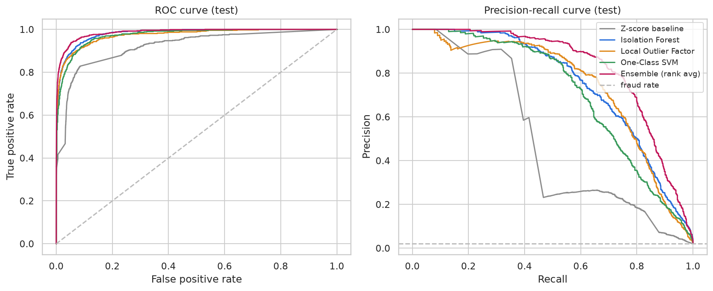
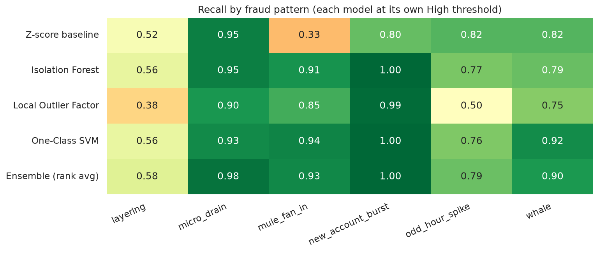
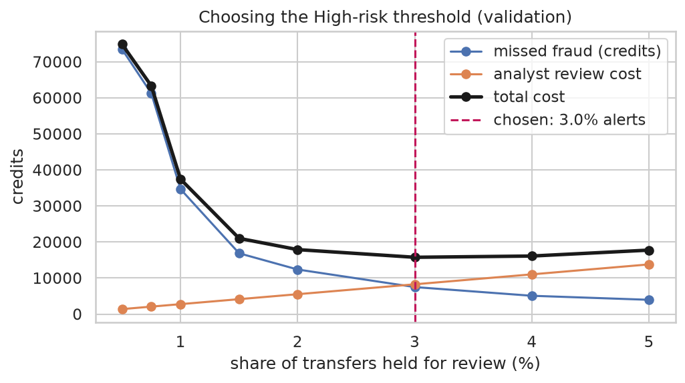
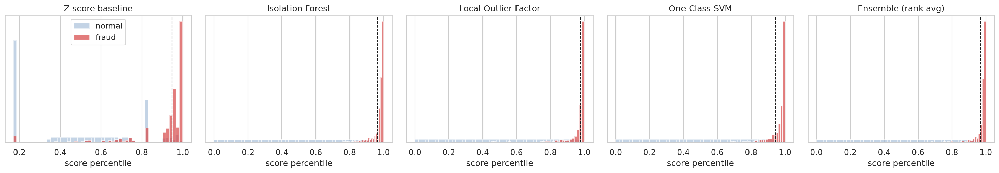
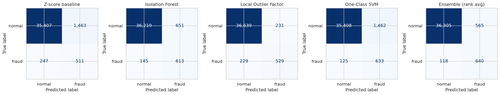
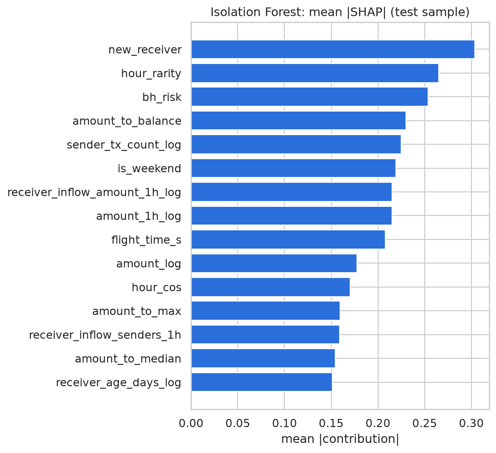
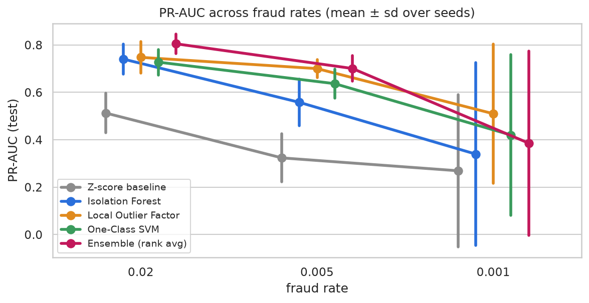

# Kronos Fraud Shield: evaluation results

Generated by `make eval` from `ensemble-20261122081923`. Test slice: days 70-90, 37,628 transfers, 2.01% fraud.

**Deployed model:** Ensemble (rank avg) (ensemble(isolation_forest + lof)). High band = top 3.0% of transfers, picked by minimising missed fraud + review cost on validation.

## Model comparison (test)

Threshold metrics use each model's own cost-optimal High threshold from validation.

| model                |   roc_auc |   pr_auc |   precision@thr |   recall@thr |   f1@thr |   alert_rate@thr |   precision@top2% |   recall@top2% |   missed_fraud_amount |   alerts |   total_cost |
|:---------------------|----------:|---------:|----------------:|-------------:|---------:|-----------------:|------------------:|---------------:|----------------------:|---------:|-------------:|
| Z-score baseline     |     0.921 |    0.468 |           0.259 |        0.674 |    0.374 |            0.052 |             0.232 |          0.467 |             32036.630 | 1974.000 |    61646.630 |
| Isolation Forest     |     0.982 |    0.750 |           0.485 |        0.809 |    0.606 |            0.034 |             0.679 |          0.674 |             18160.470 | 1264.000 |    37120.470 |
| Local Outlier Factor |     0.974 |    0.741 |           0.696 |        0.698 |    0.697 |            0.020 |             0.701 |          0.697 |             25424.190 |  760.000 |    36824.190 |
| One-Class SVM        |     0.974 |    0.705 |           0.302 |        0.835 |    0.444 |            0.056 |             0.643 |          0.639 |             12612.810 | 2095.000 |    44037.810 |
| Ensemble (rank avg)  |     0.986 |    0.822 |           0.531 |        0.844 |    0.652 |            0.032 |             0.764 |          0.759 |             12934.630 | 1205.000 |    31009.630 |

## Recall by fraud pattern

At each model's High threshold:

|                      |   layering |   micro_drain |   mule_fan_in |   new_account_burst |   odd_hour_spike |   whale |
|:---------------------|-----------:|--------------:|--------------:|--------------------:|-----------------:|--------:|
| Z-score baseline     |       0.52 |          0.95 |          0.33 |                0.80 |             0.82 |    0.82 |
| Isolation Forest     |       0.56 |          0.95 |          0.91 |                1.00 |             0.77 |    0.79 |
| Local Outlier Factor |       0.38 |          0.90 |          0.85 |                0.99 |             0.50 |    0.75 |
| One-Class SVM        |       0.56 |          0.93 |          0.94 |                1.00 |             0.76 |    0.92 |
| Ensemble (rank avg)  |       0.58 |          0.98 |          0.93 |                1.00 |             0.79 |    0.90 |

With a fixed alert budget (top 2% of transfers):

|                      |   layering |   micro_drain |   mule_fan_in |   new_account_burst |   odd_hour_spike |   whale |
|:---------------------|-----------:|--------------:|--------------:|--------------------:|-----------------:|--------:|
| Z-score baseline     |       0.12 |          0.93 |          0.03 |                0.80 |             0.62 |    0.66 |
| Isolation Forest     |       0.35 |          0.91 |          0.79 |                0.99 |             0.61 |    0.60 |
| Local Outlier Factor |       0.37 |          0.90 |          0.85 |                0.99 |             0.50 |    0.75 |
| One-Class SVM        |       0.15 |          0.90 |          0.85 |                1.00 |             0.54 |    0.62 |
| Ensemble (rank avg)  |       0.44 |          0.95 |          0.89 |                1.00 |             0.65 |    0.79 |

## Threshold choice

## Score distributions and confusion matrices

## What drives the Isolation Forest (SHAP)

| feature | mean abs SHAP |
|---|---|
| `new_receiver` | 0.304 |
| `hour_rarity` | 0.265 |
| `bh_risk` | 0.254 |
| `amount_to_balance` | 0.230 |
| `sender_tx_count_log` | 0.225 |
| `is_weekend` | 0.219 |
| `receiver_inflow_amount_1h_log` | 0.215 |
| `amount_1h_log` | 0.215 |
| `flight_time_s` | 0.208 |
| `amount_log` | 0.177 |

## Robustness: lower fraud rates and other seeds

PR-AUC on the test slice, mean ± std over 5 seeds. Smaller dataset (800 users) and the tuned hyper-parameters of the main run. A random ranker scores PR-AUC equal to the fraud rate.

| fraud rate   | Z-score baseline   | Isolation Forest   | Local Outlier Factor   | One-Class SVM   | Ensemble (rank avg)   |
|:-------------|:-------------------|:-------------------|:-----------------------|:----------------|:----------------------|
| 2.0%         | 0.513 ± 0.083      | 0.740 ± 0.063      | 0.748 ± 0.066          | 0.727 ± 0.054   | 0.805 ± 0.042         |
| 0.5%         | 0.324 ± 0.101      | 0.558 ± 0.099      | 0.700 ± 0.038          | 0.637 ± 0.061   | 0.701 ± 0.054         |
| 0.1%         | 0.269 ± 0.321      | 0.340 ± 0.386      | 0.510 ± 0.293          | 0.420 ± 0.338   | 0.386 ± 0.389         |

